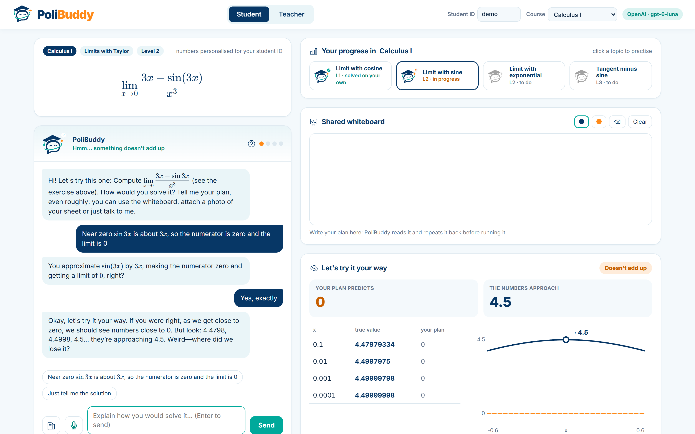

# PoliBuddy

[](https://github.com/0fmate/polibuddy/actions/workflows/tests.yml)


**An AI study buddy that runs your plan, even a wrong one, and lets you find the mistake yourself.**

Built in a team for the **Reply Student Tech Clash 2026 · AI on Campus** (Politecnico di Torino).

**Live demo:** _add the Render URL here_ · the free instance sleeps when idle, so the first load can take about a minute.



## The idea

13.5% of Italian bachelor students drop out between the first and second year (ANVUR, 2026 Report), and the
first-year "wall" exams are a big part of it. Most AI tutors respond by correcting the student or handing over
the answer. PoliBuddy does the opposite:

1. The student explains **how** they would solve the exercise: typed, on a whiteboard, in a photo or by voice.
2. PoliBuddy restates the plan ("…, right?") and, once confirmed, **runs it exactly as stated** with real maths.
3. If the plan is wrong, the numbers show where it breaks (the table goes to 4.5, not 0). The student finds the mistake.
4. Each failed attempt unlocks a bit more help: contradiction → targeted question → slide → hint. **Never the solution.**

On the teacher's side, anonymous outcomes become a radar of where the class gets stuck, and a **Crash Test** checks a
draft exam against that data before the exam.

## How it works

The language model only **understands** plans and **phrases** lines. Everything that must be right is code:

| Part | File | Role |
| --- | --- | --- |
| Interpreter | `buddy/interpreter.py` | LLM structured output → substitutions or a proposed value, **without correcting the plan**. Offline: catalog rules. |
| Engine | `buddy/engine.py` | Three engines: **limit** (SymPy + mpmath at 60 digits), **value** (physics), **trace** (our own program simulator). |
| Orchestrator | `buddy/orchestrator.py` | State machine: plan → confirmation → run → comment; the help ladder; when the work is done. |
| Buddy | `buddy/companion.py` | Lines drafted in code, rephrased by the LLM, discarded if the rephrasing leaks the solution or changes a number. |
| LLM layer | `buddy/llm.py` | Any OpenAI-compatible provider, schema-validated JSON with a fallback, daily call budget, offline fallback. |
| Teacher | `teacher/` | Anonymous radar (hidden below 10 sessions) and the Crash Test on the exam draft. |
| Front end | `web/` | Plain HTML/CSS/JS, KaTeX for every formula, whiteboard, attachments, voice conversation with transcript. |

More in [`docs/ARCHITECTURE.md`](docs/ARCHITECTURE.md); real conversations generated by the pipeline in
[`docs/EXAMPLES.md`](docs/EXAMPLES.md).

| Course | Exercises | What PoliBuddy runs |
| --- | --- | --- |
| Calculus I | 4 Taylor limits | The student's substitution, the resulting limit and a high-precision table near 0 |
| Physics I | Vertical throw, free fall | What the proposed value implies (at t = v₀/g the ball is still 20.4 m high) |
| Computer Science | `range` sum, `while` count | The program step by step in our simulator (never the student's code) |

Each student ID gets different numbers; the ID `demo` gets the demo numbers. Exercises live in `data/catalog.yaml`.

## Run it locally

```bash
python -m venv .venv
.venv/bin/pip install -r requirements-dev.txt        # Windows: .venv\Scripts\pip ...  (or just run.bat)
cp .env.example .env                                  # optional: add a free Groq key
.venv/bin/uvicorn server:app --port 8000
```

Open http://localhost:8000. **It works without any key** (offline mode, catalog rules); the badge at the top right
shows the mode. With a key, PoliBuddy understands freely written plans, reads the whiteboard and photos and
transcribes voice on the server.

### LLM provider

Any OpenAI-compatible API works through three variables:

| Provider | `LLM_BASE_URL` | Notes |
| --- | --- | --- |
| **Groq** (default) | `https://api.groq.com/openai/v1` | Free tier, fast; also Whisper for voice and a vision model |
| Google Gemini | `https://generativelanguage.googleapis.com/v1beta/openai/` | Free tier; set `LLM_REASONING_EFFORT=` empty |
| OpenRouter | `https://openrouter.ai/api/v1` | Free models (ids ending in `:free`) |
| OpenAI | _(empty)_ | Paid |

See [`.env.example`](.env.example) for every setting.

## Deploy (free)

The repo ships a [`render.yaml`](render.yaml) and a [`Dockerfile`](Dockerfile).

1. Create a free API key at [console.groq.com/keys](https://console.groq.com/keys).
2. On [render.com](https://render.com): **New → Blueprint**, pick this repository, paste the key into `LLM_API_KEY`.
3. Done: Render builds and serves the app. Health check at `/healthz`, status at `/api/status`.

The public demo is protected by a per-IP rate limit and a daily cap on model calls (`RATE_LIMIT_PER_MINUTE`,
`DAILY_LLM_CALLS`): past the cap it keeps working on offline rules. Sessions live in memory and the free instance
has an ephemeral disk, so demo data resets on restart.

## Tests

```bash
BUDDY_MODE=offline pytest -q
```

31 offline tests, run in CI on every push: the table goes to 4.5 even for tiny x, the right and the wrong plan for
all 8 exercises, the throw and `range` engines, ASCII-to-LaTeX formulas, refusal of the solution, rejection of unsafe
rephrasings, a full session with growing help, the radar threshold, the Crash Test and the HTTP API with rate limiting.

## Known limits

- Slides in the catalog are placeholders.
- The teacher dashboard mixes in **simulated sessions** for the demo (stated on the page).
- The Crash Test links questions to concepts by keywords.
- The brand and mascot were made for the hackathon and imply no affiliation with Politecnico di Torino.

## License

MIT, see [`LICENSE`](LICENSE).
